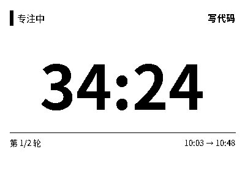
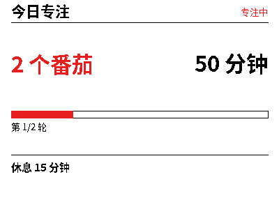

# 专注番茄（Pomodoro）

平台内置场景，**不依赖任何第三方代码**，Apache-2.0。可作为第三方 ISV 接入的参考实现。

- 场景 key：`office` 下的 `pomodoro` 模式（也可在"自由组合"里选）
- 渲染：服务端 PIL 出整图，A/B 双屏各一套版式
- 计时：**绝对时间戳 + 时长**，不存递减秒数

---

## 一、为什么不能做秒级

上游 Arduino 工程靠 0.3s 局部刷新实现秒级走字，那是单屏、有线供电的玩法。我们的设备是
双屏 + 电池，整图下发，秒级刷新一天就能把电耗光。所以：

| | 做法 |
|---|---|
| A 屏显示 | `23:41` 这种**剩余分钟**，不是 `23:41.7` |
| 时间锚点 | 底部的 `09:30 → 09:55`，用户不看表也知道几点结束 |
| 刷新触发 | 分钟数变化才推；阶段切换才整屏刷新 |
| 一天 8 个番茄 | 约 40 次推送，与"每 15 分钟刷一次天气"同一量级 |

## 二、状态模型

会话只存四样东西，其余全部现算：

```
started_at        绝对时间戳（UTC）
duration_s        本段总时长
paused_at         暂停时刻（可空）
paused_total_s    累计暂停秒数
```

由此可推导，且**断电、重启、离线一圈回来都不会走偏**：

```
end_at   = started_at + duration_s + paused_total_s
remaining = end_at - now
```

关键设计：**暂停不改锚点**。暂停只记 `paused_at`，恢复时把这段时长累加进
`paused_total_s`，`started_at` 始终不动。这样"什么时候结束"永远只有一个推导路径，
不会出现两处状态互相打架。

## 三、双屏版式

**A 屏**（黑白，每分钟变一个数字）

```
专注中 · Coding
      23:41          ← 大字号，垂直居中
──────────────────
第 2 / 4 轮         09:30 → 09:55
```

结束态会把提示换成强调色单独一行：`已超 2 分钟，该休息了`。这是最该被看见的信息。



**B 屏**（四色，变化更慢）

```
今日专注                    4/4
4 个番茄          1h 40m
──────────────────
▓▓▓▓▓▓░░░░░  2/4
下一轮休息 5 分钟
```



## 四、接口

设备侧（需设备凭证）：

| 方法 | 路径 | 说明 |
|---|---|---|
| POST | `/api/v1/devices/{device_id}/pomodoro/start` | 开始，body 可带 `preset` |
| POST | `.../pause` `.../resume` `.../skip` `.../stop` | 控制 |
| GET | `/api/v1/devices/{device_id}/pomodoro` | 当前状态 + 今日统计 |

手机侧（需用户 Token，校验设备归属）：

| 方法 | 路径 | 说明 |
|---|---|---|
| GET | `/api/v1/mobile/pomodoro/{device_id}` | 查状态 |
| POST | `/api/v1/mobile/pomodoro/{device_id}/{action}` | 同上五个动作 |
| GET | `/api/v1/pomodoro/presets` | 预设列表（公开，无需鉴权） |

返回体统一为：

```json
{
  "state": {
    "phase": "focus", "phase_label": "专注中",
    "clock": "23:41", "window": "09:30 → 09:55",
    "progress": 42, "cycle_index": 2, "cycle_total": 4,
    "next_label": "休息 5 分钟", "over": false
  },
  "stats": { "focus_count": 4, "focus_seconds": 6000 }
}
```

## 五、数据契约（给第三方开发者抄）

第三方做同类应用时，不必重复设计状态模型，按下面的契约交数据即可，平台负责渲染：

```json
{
  "title": "专注中 · Coding",
  "items": [
    { "label": "剩余", "value": "23:41", "emphasis": true },
    { "label": "轮次", "value": "第 2 / 4 轮" }
  ],
  "subtitle": "09:30 → 09:55",
  "progress": 42,
  "footer": "下一轮休息 5 分钟",
  "refresh_minutes": 1
}
```

校验规则与完整字段见 [`ISV_DATA_API.md`](./ISV_DATA_API.md)。`refresh_minutes: 1` 是
这个场景的关键——第三方如果把它设成 0（每次请求都刷新），平台会按最省电策略降到 1。

## 六、代码位置

| 文件 | 作用 |
|---|---|
| `xiaowu_platform/pomodoro.py` | 状态机、预设、A/B 视图模型（纯函数，无 IO） |
| `xiaowu_platform/store.py` | `pomodoro_sessions` / `pomodoro_daily` 两表 + `pomodoro-card` 模板 |
| `xiaowu_platform/render.py` | `_render_pomodoro` + `_draw_pomodoro_a/b` |
| `xiaowu_platform/main.py` | 上面两张表的全部路由 |
| `apps/content-console-cn/app/page.tsx` | 场景中心的"专注番茄"与参数面板 |

## 七、与上游开源项目的关系

产品形态参考了 GitHub 上的 [Rukenshia/pomodoro](https://github.com/Rukenshia/pomodoro)
（ESP32 单屏固件），但**没有任何代码复用**，仅采用「番茄工作法」这一公开方法。

该仓库无 LICENSE（默认保留所有权利），我们向它提交了改进分支作为社区贡献，
该分支与本场景**完全独立**。授权边界见 [`08-community/pomodoro-dual/NOTICE.md`](./08-community/pomodoro-dual/NOTICE.md)。
